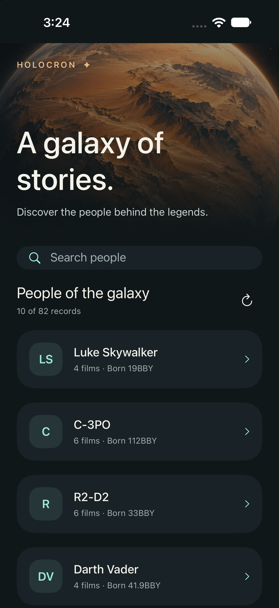
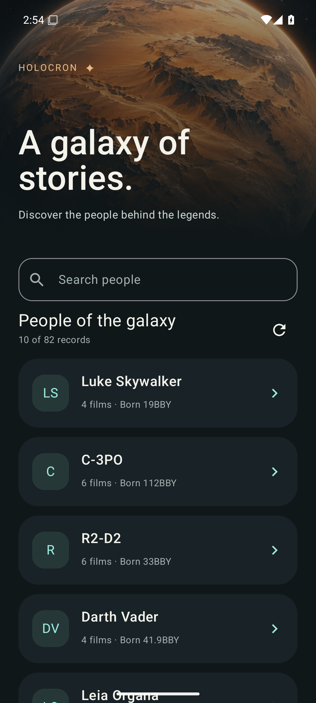
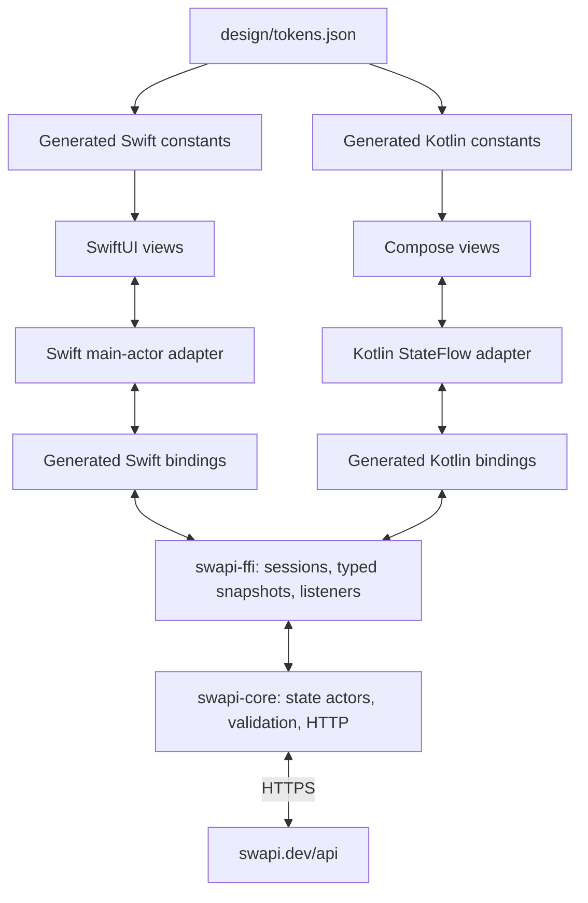

# Holocron

**A cinematic Star Wars field guide, built with two native UIs and one Rust core.**

Holocron explores the people in [SWAPI](https://swapi.dev/). Its iOS app uses
SwiftUI and its Android app uses Jetpack Compose. Both call the same Rust
library through [Mozilla UniFFI](https://mozilla.github.io/uniffi-rs/latest/).
The normal app makes real HTTPS requests to `https://swapi.dev/api/`.

<table>
  <tr>
    <td></td>
    <td></td>
  </tr>
  <tr><td>SwiftUI · iOS simulator</td><td>Jetpack Compose · Android emulator</td></tr>
</table>

These are native screenshots with live API data, captured on October 17, 2026.
The orbital illustration is original atmospheric artwork; SWAPI does not supply
character portraits. Holocron is a provisional project name.

Jump to [Android setup](#build-and-run-android), [iOS setup](#build-and-run-ios-on-a-mac),
[configuration](#configuration-and-generation), or [verification](#testing-fixtures-and-artifacts).

## Why this project exists

This is a small, complete experiment in sharing application behavior without
giving up native UI. SWAPI offers a manageable domain with enough real-world
edges—string-valued measurements, pagination, searches, failures and changing
screens—to test the boundary properly.

The aim is to demonstrate three things:

- **One implementation of behavior.** Networking, validation, query timing,
  pagination, retry decisions and state transitions belong in Rust.
- **Native interaction and visual quality.** SwiftUI and Compose own navigation,
  layout, text scaling, accessibility, gestures and rendering. Shared tokens and
  original artwork give them a consistent visual identity.
- **An inspectable engineering workflow.** Versioned specifications, small
  typed interfaces, deterministic fixtures, reproducible generation, native
  integration tests and retained artifacts make changes easier to verify.

The development approach adapts the supplied harness-engineering guide. See
[the rationale](docs/harness.md) and [project instructions](AGENTS.md).
[Beads](.agents/skills/beads/SKILL.md) is the persistent work tracker.

## What works

Browse People, search by name, load additional pages, open a character, and
return to the list. Character detail shows height, mass, birth year, eye and
hair color, and film count. Refresh and retry are available where appropriate.

Rust debounces queries for 300 ms and cancels obsolete requests. Refresh and
pagination retain useful content; page failures can retry the failed page.
Duplicate requests and duplicate records are handled centrally. Unknown and
not-applicable measurements remain distinct typed values.

Both apps support light/dark appearance and native text scaling. Search drafts,
focus, scroll position and navigation are native concerns. Android retains its
query across activity recreation; both platforms are tested across navigation
and background/foreground transitions.

This is a development application. It currently has no accounts, favorites,
offline persistence, relationship browsing, or release/distribution setup.

## Architecture



| Layer | Responsibility |
| --- | --- |
| `crates/swapi-core` | reqwest/Rustls HTTP, parsing, validated records, query/debounce, pagination, refresh and cancellation |
| `crates/swapi-ffi` | UniFFI records/enums, command methods, callback subscriptions and lifetime boundary |
| `bindings/` | Generated Swift/Kotlin sources, Swift C header and module map |
| `ios/Holocron` | Swift main-actor models, SwiftUI screens and NavigationStack |
| `android/app` | Main-thread StateFlow adapters, ViewModels, Compose screens and NavHost |
| `design/tokens.json` | Shared palettes, spacing, shapes, typography and motion intent |
| `scripts/` | Tool setup, binding/token generation, builds, fixtures, verification and Mac transport |

Each state actor serializes commands on Tokio. It publishes immutable snapshots
with increasing revisions; slow subscribers may skip intermediate snapshots.
Adapters reject stale deliveries, marshal updates onto their UI thread, and
invalidate subscriptions when their owner is disposed. No animation frame or
keyboard event loop crosses FFI.

The Rust runtime has two worker threads. HTTP uses a bundled trust store,
15-second timeout and 1 MiB response limit. Redirects and automatic retries are
disabled. The core validates resource and pagination URLs, and classifies which
failures can be retried. Native code formats user-facing messages and values.

Read [ARCHITECTURE.md](ARCHITECTURE.md) for the complete boundary and lifecycle
contract, and [the design system](docs/design-system.md) for visual intent.

## Prerequisites and supported environments

| Work | Environment |
| --- | --- |
| Rust development | Rust/rustup, Python 3.12+, a native C compiler/linker, Git |
| Android | Linux x86_64 for the supplied bootstrap; KVM access for practical emulator testing |
| iOS | Apple Silicon Mac, full Xcode with command-line tools and an installed iOS 18+ simulator runtime |
| Remote iOS from Linux | SSH access to the Mac, a verified host key, and rsync on both machines |

Install [rustup](https://rustup.rs/) if it is not already available. The repository
pins Rust **1.97.1** and UniFFI **0.32.2**. Runtime and binding generator must
always use the same UniFFI version. `Cargo.lock` pins resolved dependencies.

Android pins Gradle 8.13, AGP 8.13.2, Kotlin 2.2.21, Compose BOM 2025.12.00,
SDK 36, Build Tools 35.0.0 and NDK 28.2.13676358. Minimum Android API is 26.
iOS targets iOS 18+ with Swift 6. The packaged Rust targets are Android arm64
and x86_64, plus Apple arm64 device and simulator. Intel Mac simulators are not
included.

Actual native verification has used a Pixel 7 AVD on Android API 36 and an
iPhone 18 Pro simulator on iOS 27.0, built with Xcode 27.1 on an M4 Mac. These
results do not establish physical-device performance or minimum-OS compatibility.

## Get the source and check the core

From a checkout of this repository:

```sh
rustup toolchain install 1.97.1 --profile minimal --component rustfmt --component clippy
python3 scripts/doctor.py
python3 scripts/verify.py core
```

`doctor.py` reports local capabilities without installing anything. Verification
checks generated tokens and bindings, documentation links, Rust formatting,
offline tests and Clippy. Logs and a machine-readable summary go under
`.artifacts/verification/core/`.

For an explicit live API smoke test:

```sh
cargo run --locked -p swapi-core --example luke
```

Live API availability is deliberately separate from the deterministic test suite.

## Build and run Android

The Linux bootstrap installs checksum-verified tool archives and Android SDK
packages beneath `~/.local/share/holocron`; it does not require sudo. Installing
the requested SDK tools includes accepting their SDK licenses.

```sh
python3 scripts/setup-android.py
source scripts/android-env.sh
./android/gradlew -p android assembleDebug lintDebug
```

Gradle's `preBuild` checks tokens, regenerates UniFFI bindings and compiles Rust
for `arm64-v8a` and `x86_64`. Both libraries use 16 KiB segment alignment.
The debug APK is `android/app/build/outputs/apk/debug/app-debug.apk`.

Create an emulator once:

```sh
source scripts/android-env.sh
printf 'no\n' | avdmanager create avd -n holocron-api36 \
  -k 'system-images;android-36;google_apis;x86_64' -d pixel_7
emulator -avd holocron-api36 -no-audio -no-snapshot -gpu swiftshader \
  -memory 2048 -cores 2 -port 5554
```

Use `-no-window` for a headless emulator. Wait until
`adb -s emulator-5554 shell getprop sys.boot_completed` reports `1`, then in
another terminal:

```sh
source scripts/android-env.sh
export ANDROID_SERIAL=emulator-5554
adb install -r android/app/build/outputs/apk/debug/app-debug.apk
adb shell wm dismiss-keyguard
adb shell am start -n dev.holocron.app/.MainActivity
```

For a connected Android device, enable developer options/USB debugging, accept
the computer on the device, and select its serial from `adb devices`. Only the
listed ABIs are packaged. The APK is debug-signed, not a store release.

Run all Android verification against a booted device:

```sh
source scripts/android-env.sh
ANDROID_SERIAL=emulator-5554 python3 scripts/verify.py android
```

## Build and run iOS on a Mac

Install full Xcode, finish its first-launch setup, and install an iOS simulator
runtime in Xcode Settings. `xcode-select -p` should point into the chosen Xcode,
not the standalone Command Line Tools package. In the project checkout:

```sh
bash scripts/setup-mac.sh
export PATH="$HOME/.cargo/bin:$PATH"
bash scripts/generate-bindings.sh
bash scripts/build-rust-ios.sh
export HOLOCRON_SIMULATOR="$(python3 scripts/select-ios-simulator.py)"
python3 scripts/verify.py ios
```

The Rust build creates `ios/Frameworks/HolocronCoreFFI.xcframework` with separate
arm64 device and simulator slices. The verification command builds it, runs
fixture-backed XCTest suites and compiles an unsigned device app. No Apple
Developer account is needed for simulator verification.

To launch with the real API after testing:

```sh
xcrun simctl bootstatus "$HOLOCRON_SIMULATOR" -b
xcrun simctl install "$HOLOCRON_SIMULATOR" \
  .artifacts/ios/DerivedData/Build/Products/Debug-iphonesimulator/Holocron.app
xcrun simctl launch --terminate-running-process "$HOLOCRON_SIMULATOR" dev.holocron.app
```

For interactive development, open `ios/Holocron.xcodeproj`, select the Holocron
scheme and an iPhone simulator, then run. Generate bindings and the XCFramework
first. Physical iPhone installation requires selecting a signing team and a
unique bundle identifier as needed; distribution signing is not configured.

### Build iOS remotely from Linux

Enable **System Settings → General → Sharing → Remote Login** for your Mac
account, install the Linux machine's public SSH key in `~/.ssh/authorized_keys`,
and verify the Mac's SSH host fingerprint through a trusted channel. Keep
private keys outside this repository. The Mac must be awake and reachable.

```sh
export HOLOCRON_MAC=user@your-mac.local
export HOLOCRON_MAC_KEY="$HOME/.ssh/holocron_m4_ed25519"
export HOLOCRON_MAC_KNOWN_HOSTS="$HOME/.ssh/holocron_m4_known_hosts"
bash scripts/generate-bindings.sh
bash scripts/mac.sh sync
bash scripts/mac.sh run bash scripts/setup-mac.sh
bash scripts/mac.sh run python3 scripts/select-ios-simulator.py
# Use the UUID printed by the preceding command:
bash scripts/mac.sh run env HOLOCRON_SIMULATOR=YOUR_SIMULATOR_UUID python3 scripts/verify.py ios
bash scripts/mac.sh pull
```

`mac.sh` uses strict host-key verification and a marked checkout at
`~/Developer/holocron-codex`. It syncs sources without build caches or the live
Beads database. Results are pulled into `.artifacts/ios/mac/`.

The earlier OSX-KVM experiment reached macOS recovery only. The working Apple
build/test path is the physical Mac; see [environment details](docs/development.md).

## Configuration and generation

| Setting | Purpose / default |
| --- | --- |
| Production endpoint | `https://swapi.dev/api/`; no API key or `.env` file required |
| `ANDROID_SERIAL` | Device/emulator selected for verification and adb |
| `JAVA_HOME`, `ANDROID_HOME`, `HOLOCRON_TOOLS` | Override the local tool locations used by `android-env.sh` |
| `CARGO_BUILD_JOBS` | Rust build parallelism; native build scripts default to 4 |
| `HOLOCRON_SIMULATOR` | UUID used by iOS tests |
| `HOLOCRON_RECORD=1` | Save an iOS test interaction video alongside the result bundle |
| `HOLOCRON_MAC` | SSH `user@host` for remote Apple builds |
| `HOLOCRON_MAC_KEY`, `HOLOCRON_MAC_KNOWN_HOSTS` | SSH identity and verified host-key file |

Tool overrides must refer to compatible versions. There is no general-purpose
remote API override: the Rust test constructor permits the exact production URL
or a loopback HTTP endpoint under `/api/` and rejects arbitrary remote hosts.

Change Rust exports or the token JSON, then regenerate their outputs:

```sh
bash scripts/generate-bindings.sh
python3 scripts/generate-design.py
# Check without rewriting checked-in files:
bash scripts/generate-bindings.sh --check
python3 scripts/generate-design.py --check
```

Do not edit generated files. Token checks also verify semantic text colors
against solid surfaces at 4.5:1; text over artwork requires native visual review.
Motion intent is shared, while animation execution stays native.

## Testing, fixtures and artifacts

The Rust suite covers HTTP parsing, validation, timeout/error policy, state
ordering, debounce, cancellation, pagination, refresh and listener lifetimes.
The verified suite has 20 Rust tests, six Android instrumentation tests and
eight iOS tests. Native tests call the **packaged Rust library through generated bindings**.
They exercise navigation, failed-page retry, empty search, selected-character
refresh, cleanup, backgrounding, recreation and accessibility checks.

Ordinary tests use loopback HTTP servers. The iOS fixture server is
`scripts/ios-fixture-server.py`, bound to `127.0.0.1:18765`; `test-ios.sh` starts
and stops it. Android tests start an in-process loopback server. Test records
are synthetic and should not be interpreted as canonical character facts.

Debug builds permit explicit fixture injection: iOS accepts `--endpoint URL`
and Android accepts an `endpoint` intent extra. Normal launches omit them and
use the live API. The iOS `--detail` debug argument opens the original isolated
character test screen. Release builds ignore these debug launch overrides.

| Evidence | Location |
| --- | --- |
| Verification step logs and JSON summaries | `.artifacts/verification/{core,android,ios}/` |
| Android test reports and lint | `android/app/build/reports/` |
| Android instrumented test XML | `android/app/build/outputs/androidTest-results/` |
| Android captured screens and frame statistics | `.artifacts/verification/android/screenshots.tar` |
| XCTest results, screenshots, optional video | `.artifacts/ios/*.xcresult`, `.artifacts/ios/*.mp4` |
| Pulled Mac results | `.artifacts/ios/mac/` |

These generated artifacts are ignored by Git. The README's selected native
screenshots are versioned under `docs/images/`. See [verification details](docs/testing.md)
for measured conditions, results and limits.

### Continuous integration

[The workflow](.github/workflows/verify.yml) defines separate Rust, Android and
Apple Silicon iOS jobs. It invokes the same local scripts and uploads available
reports, screenshots/test bundles and the debug APK even when a test fails. Dependencies
are pinned in project manifests; SDK package indexes and hosted runner images
can still change.

There is currently no Git remote. The workflow has been prepared locally;
hosted job execution and artifact upload require connecting the repository to
GitHub and enabling Actions. A local passing run is not a hosted-CI result.

## Work tracking and contributing

Read [AGENTS.md](AGENTS.md), then use Beads for work spanning multiple steps:

```sh
bd prime
bd ready --json
bd list --status in_progress --json
python3 scripts/check-beads.py
```

The local `bd` 1.2.2 embedded backend does not support `bd doctor`, and its lint
command reports zero coverage. `check-beads.py` is the documented read-only
alternative: it rejects an empty database, validates required issue fields,
checks independent readback and dependency references, and detects cycles.
It does not claim physical Dolt storage integrity.

Beads uses a local Dolt database excluded from Git. Cloning source does not
clone its issue database. Use supported `bd backup` / Dolt remote operations
for backup and synchronization; JSON exports are not the live database.
No source or issue remote is configured automatically.

Keep behavior in Rust, UI interaction in native code, and generated artifacts
reproducible. Add regression tests for request races and lifecycle changes;
inspect native screenshots when changing layout. Preserve asset provenance.
A repository license has not yet been selected; choose one before publishing
this as a reusable open-source project.

## Troubleshooting and limits

| Symptom | What to check |
| --- | --- |
| Gradle cannot find Java/SDK/NDK | Source `scripts/android-env.sh`; inspect overrides and rerun the bootstrap if the pinned packages are missing. |
| Emulator fails or is extremely slow | Check `/dev/kvm` access and virtualization support; confirm the selected ABI/image and available RAM. |
| No Android device selected | Run `adb devices` and set `ANDROID_SERIAL` explicitly. |
| Native symbols or generated bindings disagree | Regenerate bindings and rebuild both target Rust libraries from the same checkout. |
| Xcode reports missing XCFramework | Run `scripts/build-rust-ios.sh` on the Mac after binding generation. |
| iOS tests cannot find a destination | Install an iOS 18+ runtime and run `scripts/select-ios-simulator.py`. |
| Fixture port 18765 is occupied | Stop the previous fixture process; tests deliberately fail instead of using an unknown server. |
| Mac SSH fails host verification | Confirm the host fingerprint out of band and update the dedicated known-hosts file; do not disable verification. |
| API is unavailable | Use retry in the app; run offline verification separately to distinguish service failure from a regression. |
| Browser concept cannot be reviewed | The historical HTML preview is not the runtime app; native screenshots/tests are the current design evidence. |

The verified delivery is a simulator/emulator development build. Physical-device
frame performance, a full manual VoiceOver/TalkBack review, minimum-OS runtime
coverage, signing, store metadata, branding and release asset review remain
release-readiness concerns. Frame measurements from the software-rendered Android
emulator and iOS simulator are diagnostic baselines, not promises of device FPS.

## Further reading

- [Product scope](docs/product.md)
- [Architecture and state/lifetime contract](ARCHITECTURE.md)
- [Visual design system](docs/design-system.md)
- [Detailed environment and Mac setup](docs/development.md)
- [Verification and measured evidence](docs/testing.md)
- [Harness engineering approach](docs/harness.md)
- [Original design concept and asset provenance](design/concepts/holocron/README.md)
