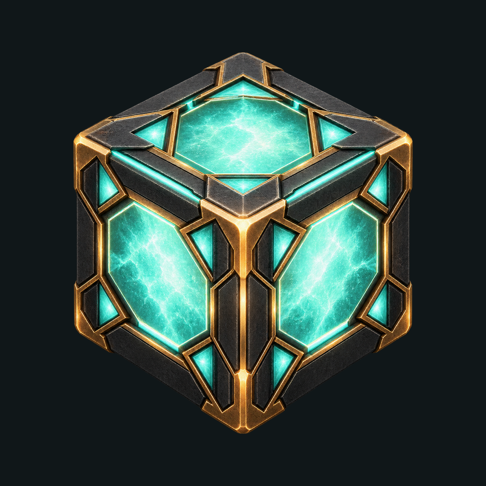

# Holocron app icon



The shared icon is a sculpted holocron cube with luminous mint-cyan panels,
graphite faces, and amber metal framing. It follows the accepted app palette
and preserves the cube motif of the earlier Android outline icon. The artwork
contains no text so it can serve both native apps while the name is provisional.

## Source and provenance

[holocron-source.png](holocron-source.png) is the original 1254 × 1254 RGBA
output from the built-in `image_gen` tool, generated October 18, 2026.
[prompt.txt](prompt.txt) records the exact prompt. The tool supplied true alpha;
no background removal or artistic repainting was applied afterward. This is
generated artwork for this fan project, not an official franchise asset or a
film still. No external stock imagery is included.

[monochrome.xml](monochrome.xml) is an authored simplification of the same
three-face cube, with solid inset panels and a strong outline for themed icons.
Change this source rather than its generated Android copy.

## Native packaging

- **iOS:** an opaque RGB 1024 × 1024 PNG in
  [AppIcon.appiconset](../../ios/Holocron/Assets.xcassets/AppIcon.appiconset/).
  Both app build configurations select `AppIcon`. Xcode derives the smaller
  iPhone/iPad sizes from this universal entry. The OS supplies the corner mask.
  This is a conventional asset-catalog icon; custom dark/tinted artwork and
  Icon Composer layers are not supplied.
- **Android:** a transparent 432 × 432 foreground bitmap represents a
  108 × 108 dp layer at 4 px/dp. The visible cube is centered at 60 dp high,
  inside the adaptive safe zone; the graphite background is a separate layer.
  API 26+ uses the color icon; API 33+ also provides a monochrome layer for
  launchers with themed icons enabled. Android's minimum SDK is 26, so a
  pre-adaptive launcher fallback is unnecessary. No corner mask is baked in.

The retained source is trimmed by its visible alpha bounds, resized, padded,
and composited for these technical exports. The iOS background comes from
[design tokens](../tokens.json); Android uses the same graphite launcher color.

## Reproduce the exports

From the repository root, using Python with Pillow (verified with 10.2.0):

```sh
python3 -m venv .artifacts/icon-tools
.artifacts/icon-tools/bin/pip install -r design/app-icon/requirements.txt
.artifacts/icon-tools/bin/python scripts/generate-app-icons.py
.artifacts/icon-tools/bin/python scripts/generate-app-icons.py --check
python3 scripts/check_docs.py
```

[generate-app-icons.py](../../scripts/generate-app-icons.py) packages the retained
source; it does not call image generation or need an API key. `--check` compares
decoded pixels and metadata, and rejects resource drift without rewriting files.
Re-generation of the AI artwork itself is not deterministic.

## Platform references

- [Apple: configuring an icon with an asset catalog](https://developer.apple.com/documentation/xcode/configuring-your-app-icon)
- [Android: adaptive layers, safe zone, and monochrome icons](https://developer.android.com/develop/ui/compose/system/icon_design_adaptive)

The image above is an asset preview. Actual launcher evidence and remaining
platform limits are recorded in [testing](../../docs/testing.md).
