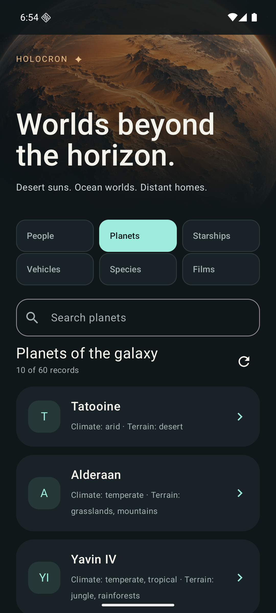
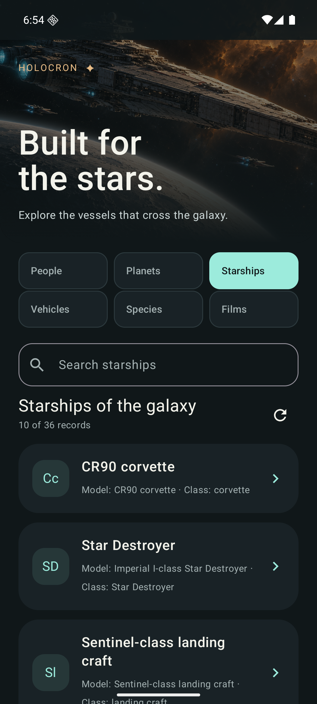
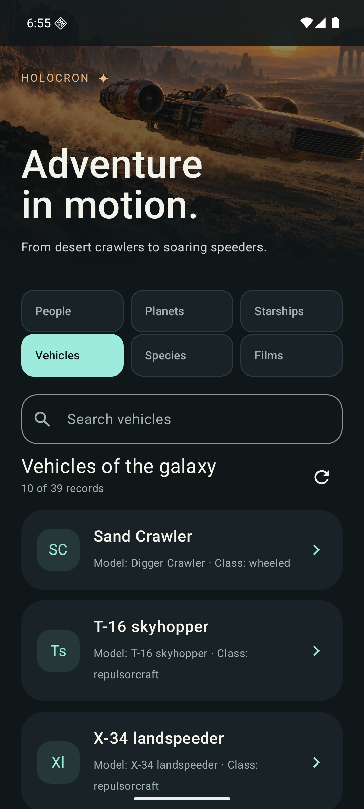
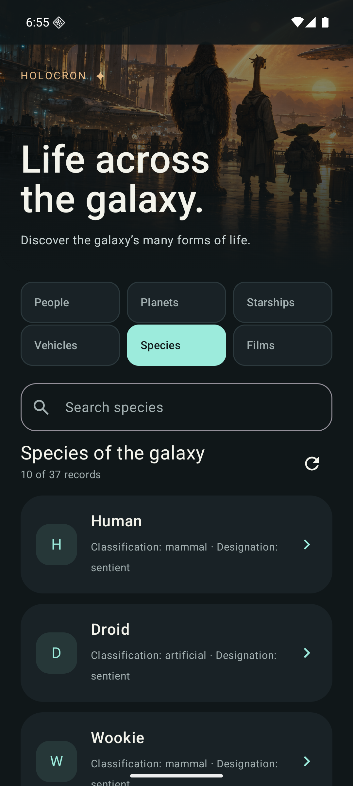
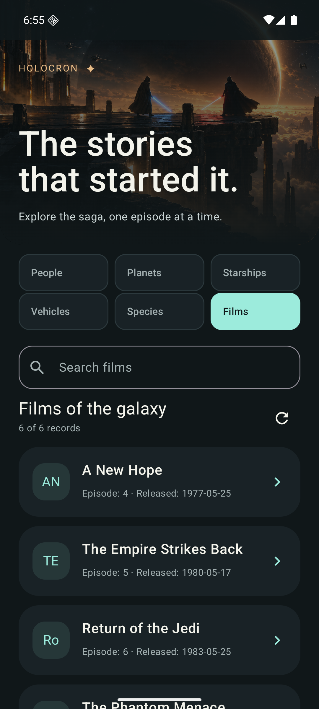

# Category artwork

The native apps bundle six atmospheric illustrations. The images establish a
category's mood; they do not identify the selected person, planet, ship, vehicle,
species, or film and are not returned by SWAPI.

| Category | Native asset | Art direction |
| --- | --- | --- |
| People | `hero_people` | A spacefaring crew in a shadowy hangar |
| Planets | `desert_orbit` | The original amber desert planet, preserved unchanged |
| Starships | `hero_starships` | A weathered cruiser in deep space |
| Vehicles | `hero_vehicles` | A landspeeder crossing a remote desert |
| Species | `hero_species` | A gathering of alien travelers |
| Films | `hero_films` | An epic energy-sword confrontation beneath the stars |

## Native Android review

These screenshots show the bundled artwork in the actual Android emulator with
live SWAPI records, including the native crop and text overlays.

| People | Planets | Starships |
| --- | --- | --- |
|  |  |  |

| Vehicles | Species | Films |
| --- | --- | --- |
|  |  |  |

## Provenance and integration

The five category additions were generated on October 17, 2026 with the built-in
`image_gen` tool. Their complete generation prompts are in
[category-prompts.json](category-prompts.json). The original planet's provenance
and prompt remain in the [concept documentation](../concepts/holocron/README.md).
These are generated illustrations for this fan project, not licensed film stills
or official Star Wars promotional assets. No external stock assets or hotlinks
are used, and no claim of franchise affiliation is made.

The final image files live in
[Android resources](../../android/app/src/main/res/drawable-nodpi/) and are copied
byte-for-byte into the [iOS asset catalog](../../ios/Holocron/Assets.xcassets/).
Each native `CatalogCategory.artwork` mapping selects the same asset for its
collection and detail screens. Artwork is decorative for assistive technology;
native text and category controls provide the labels. Native gradients preserve
the shared dark hero treatment in both light and dark appearance.

When changing an image, keep its counterpart in the other platform identical
and review the actual native crop, heading contrast, search state, detail screen,
and enlarged text. A source image alone does not establish the rendered result.
